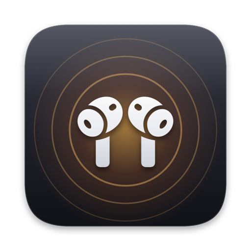

<p align="center">
  
</p>

<h1 align="center">AirLink, CMF Link &amp; ClipSync</h1>

<p align="center">
  <b>Small, native apps that put your earbuds and your phone one click away.</b><br>
  No accounts, no cloud, no dependencies.
</p>

<p align="center">
  <a href="https://nk1044.github.io/airlink-releases/">Website</a> ·
  <a href="https://github.com/nk1044/airlink-releases/releases/latest">Latest release</a>
</p>

<p align="center">
  <a href="https://github.com/nk1044/airlink-releases/actions/workflows/build-airlink.yml"></a>
  <a href="https://github.com/nk1044/airlink-releases/actions/workflows/build-cmflink.yml"></a>
  <a href="https://github.com/nk1044/airlink-releases/actions/workflows/build-clipsync-desktop.yml"></a>
  <a href="https://github.com/nk1044/airlink-releases/actions/workflows/build-clipsync-android.yml"></a>
  <a href="https://github.com/nk1044/airlink-releases/releases/latest"></a>
</p>

---

## The apps

| App | What it does | Platform | Download |
|---|---|---|---|
| [**AirLink**](airlink-mac) | realme Buds Air 6 Pro in the menu bar: battery for each bud and the case, one-click noise control | macOS 14+, Apple silicon and Intel | [AirLink.dmg](https://github.com/nk1044/airlink-releases/releases/latest/download/AirLink.dmg) |
| [**CMF Link**](cmflink) | CMF Buds 2a in the tray: battery, noise control, EQ, Ultra Bass, gestures, find my buds | Windows 10 2004+, x64 | [CmfLink-win-x64.zip](https://github.com/nk1044/airlink-releases/releases/latest/download/CmfLink-win-x64.zip) |
| [**ClipSync**](clipsync-desktop) for Windows | Syncs the clipboard (text and images) with your phone and sends files, over Wi-Fi or Bluetooth | Windows 10+ | [ClipSync.exe](https://github.com/nk1044/airlink-releases/releases/latest/download/ClipSync.exe) |
| [**ClipSync**](clipsync-android) for Android | The phone side: a Quick Settings tile and a "Send to PC" share target | Android 13+ | [ClipSync.apk](https://github.com/nk1044/airlink-releases/releases/latest/download/ClipSync.apk) |

Every release is built from this repository by GitHub Actions and ships all four apps, plus `SHA256SUMS.txt` with a checksum for each file. None of the apps is signed by Apple or Microsoft, so the first launch asks for confirmation; each app's section below says how.

## AirLink (macOS)

A native menu bar app for the **realme Buds Air 6 Pro**. The icon only appears while your buds are connected to the Mac. It shows battery for each bud and the case as rings, and switches between Noise Cancellation, Transparency and Off in one click. It uses about 13 MB of memory and 0.0 % CPU while idle.

**Install:** download [AirLink.dmg](https://github.com/nk1044/airlink-releases/releases/latest/download/AirLink.dmg), drag AirLink to Applications, and open it. macOS asks first because the app isn't notarized: click **Done**, then **System Settings › Privacy & Security › Open Anyway**.

Full docs, including build steps, the probe tool and adding other buds: [airlink-mac/README.md](airlink-mac/README.md) · Protocol notes: [airlink-mac/PROTOCOL.md](airlink-mac/PROTOCOL.md)

## CMF Link (Windows)

The Windows counterpart of AirLink, for the **CMF Buds 2a**: battery, noise control, equalizer and custom EQ, Ultra Bass, low-latency mode, gesture remapping, find my buds and dual-connection management, all from a Windows 11-style tray flyout. It hands the buds' controls back to the Nothing X app on your phone when you're not using it.

**Install:** install the [.NET 10 Desktop Runtime](https://dotnet.microsoft.com/download/dotnet/10.0) (x64), then download [CmfLink-win-x64.zip](https://github.com/nk1044/airlink-releases/releases/latest/download/CmfLink-win-x64.zip), unzip it anywhere and run `CmfLink.exe`.

Full docs: [cmflink/README.md](cmflink/README.md) · Protocol notes: [cmflink/PROTOCOL.md](cmflink/PROTOCOL.md)

## ClipSync (Windows + Android)

Copy on the PC, paste on the phone, and the other way round. ClipSync keeps the clipboard in sync between a Windows PC and an Android phone, including images, and sends files both ways. Everything stays on your local network: it uses Wi-Fi, falls back to Bluetooth, and encrypts every message with a key the two devices agree on when you link them. There's no account and no cloud.

- **Windows:** a single ~90 KB `ClipSync.exe` with no installer and no runtime. It lives in the tray, reacts to clipboard events instead of polling, and adds **Send to › Phone (ClipSync)** in Explorer.
- **Android:** no AndroidX and no notifications. Tap the **ClipSync** Quick Settings tile to send the phone's clipboard, or use **Share › Send to PC** for images and files.

**Install:**
1. On the PC, download [ClipSync.exe](https://github.com/nk1044/airlink-releases/releases/latest/download/ClipSync.exe) and run it. SmartScreen may ask first: click **More info › Run anyway**. Allow it through the firewall on private networks.
2. On the phone, download [ClipSync.apk](https://github.com/nk1044/airlink-releases/releases/latest/download/ClipSync.apk) and install it.
3. On the PC, right-click the ClipSync icon near the clock and choose **Link a phone**. In the phone app, tap **Link with PC**, check that both show the same code, and click **Link** on the PC. Both need to be on the same Wi-Fi the first time.

Design notes: [clipsync-desktop/plan.md](clipsync-desktop/plan.md) · [clipsync-android/plan.md](clipsync-android/plan.md)

## Repository layout

```
airlink-mac/          AirLink: macOS menu bar app (Swift package)
cmflink/              CMF Link: Windows tray app (.NET 10, WPF)
clipsync-desktop/     ClipSync for Windows (C17, Win32, MinGW-w64)
clipsync-android/     ClipSync for Android (Kotlin, framework APIs only)
website/              the project website (static HTML/CSS/JS, deployed to GitHub Pages)
.github/workflows/    one build workflow per app, the release and the website deployment
```

## Building from source

| App | Needs | Build |
|---|---|---|
| AirLink | Xcode Command Line Tools (Swift 6) | `cd airlink-mac && swift build && swift test` (see [its README](airlink-mac/README.md#build-from-source) for signing and the DMG) |
| CMF Link | [.NET 10 SDK](https://dotnet.microsoft.com/download/dotnet/10.0) | `cd cmflink && dotnet test && dotnet publish src/CmfLink.App -c Release -o dist/CmfLink` |
| ClipSync (Windows) | MinGW-w64 gcc from [MSYS2](https://www.msys2.org/) UCRT64 on `PATH` | `cd clipsync-desktop && build.bat` → `build\clipsync.exe` |
| ClipSync (Android) | JDK 17 and the Android SDK (Android Studio has both), Gradle 8.14 | Open `clipsync-android` in Android Studio, or `gradle assembleRelease` → `app/build/outputs/apk/release/` |

## CI and releases

Each app has its own workflow, which runs only when files in that app's folder change (edits to Markdown docs don't count) and uploads the build as an artifact on the run's page:

| Workflow | Runs on | Produces |
|---|---|---|
| [build-airlink.yml](.github/workflows/build-airlink.yml) | macOS | build and tests (the DMG on release) |
| [build-cmflink.yml](.github/workflows/build-cmflink.yml) | Windows | tests, `CmfLink-win-x64.zip` |
| [build-clipsync-desktop.yml](.github/workflows/build-clipsync-desktop.yml) | Windows (MSYS2) | `ClipSync.exe` |
| [build-clipsync-android.yml](.github/workflows/build-clipsync-android.yml) | Linux | `ClipSync.apk` |
| [pages.yml](.github/workflows/pages.yml) | Linux | deploys `website/` to GitHub Pages |

To release, push a version tag:

```sh
git tag v1.1.0 && git push origin v1.1.0
```

The [release workflow](.github/workflows/release.yml) rebuilds only the apps whose folder changed since the previous `v*` release, stamped with the new version. It copies the other apps' files over from that release unchanged, and publishes all four together as one GitHub Release. The release notes say which apps were updated. Because every release carries every app, the `releases/latest/download/<file>` links on the website and in this README always work. To rebuild everything anyway, run the workflow by hand (**Actions › Release › Run workflow**) with **build_all** checked.

**Android signing.** Android only installs an update over an app signed with the same key. To give every release the same key, add these repository secrets (**Settings › Secrets and variables › Actions**):

| Secret | Value |
|---|---|
| `CLIPSYNC_KEYSTORE_BASE64` | the keystore file, base64-encoded |
| `CLIPSYNC_KEYSTORE_PASSWORD` | the keystore password |
| `CLIPSYNC_KEY_ALIAS` | the key's alias |
| `CLIPSYNC_KEY_PASSWORD` | the key's password |

Create a keystore once and keep it safe; losing it means users have to uninstall before updating:

```sh
keytool -genkeypair -v -keystore clipsync.jks -alias clipsync -keyalg RSA -keysize 4096 -validity 10000
base64 -w0 clipsync.jks    # the value for CLIPSYNC_KEYSTORE_BASE64 (macOS: base64 -i clipsync.jks)
```

Without the secrets the APK is still built, signed with a throwaway debug key, and the workflow prints a warning.

---

These are independent projects, not affiliated with or endorsed by realme, OPPO, Nothing, CMF, Apple, Microsoft or Google. All trademarks belong to their owners.
